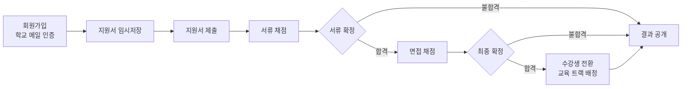
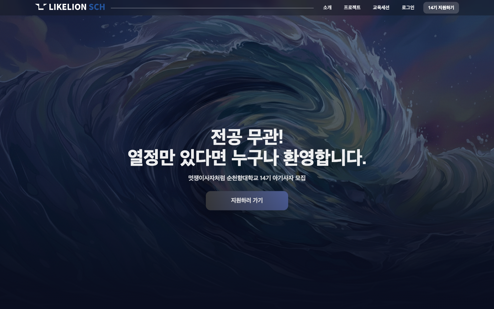
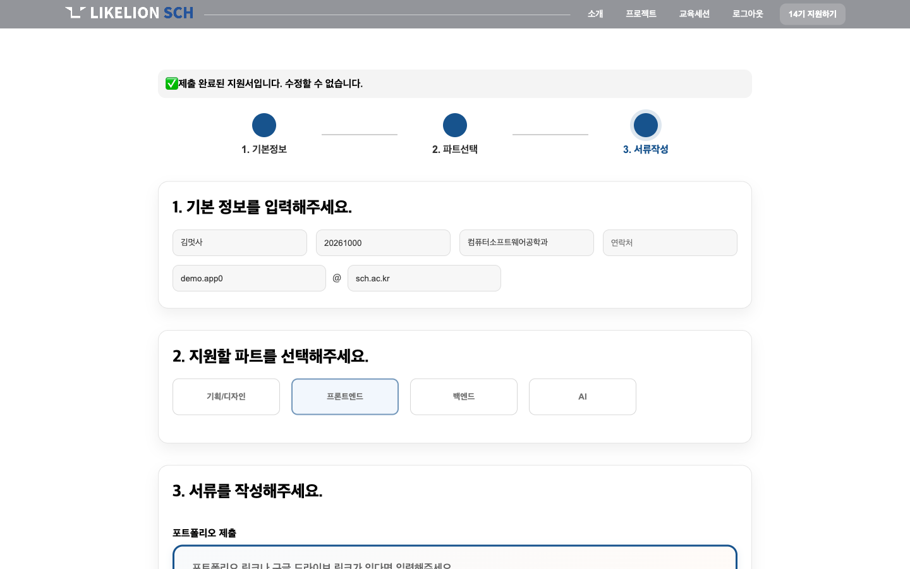
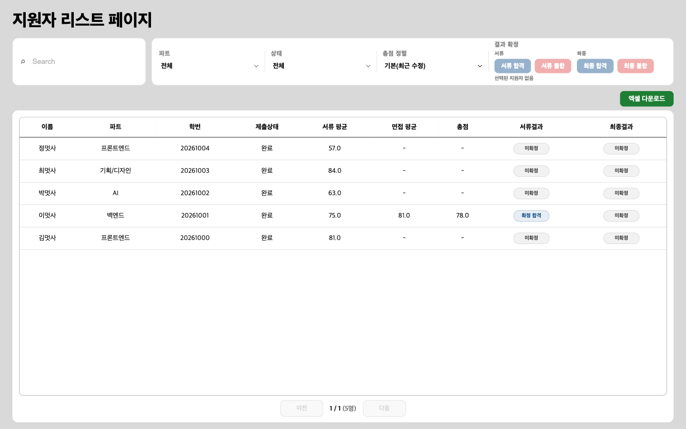
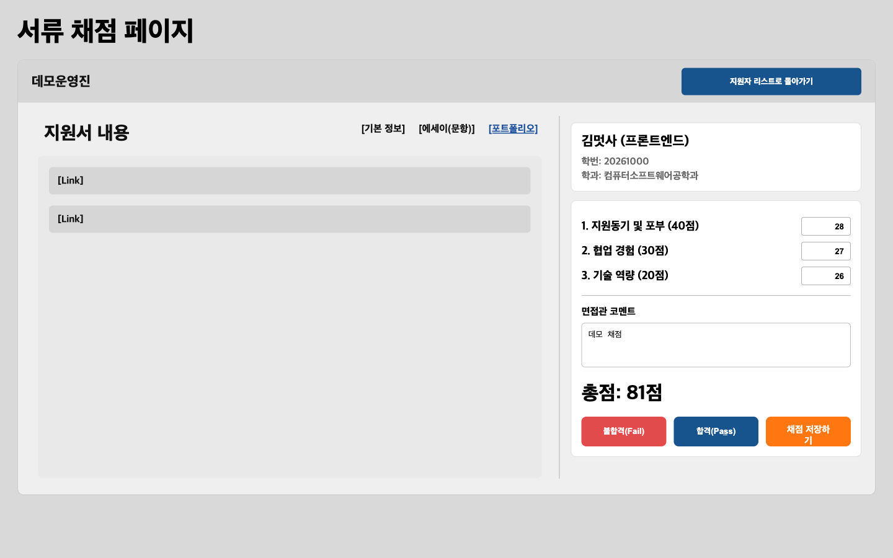
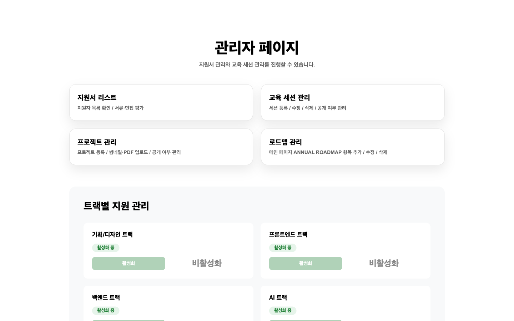
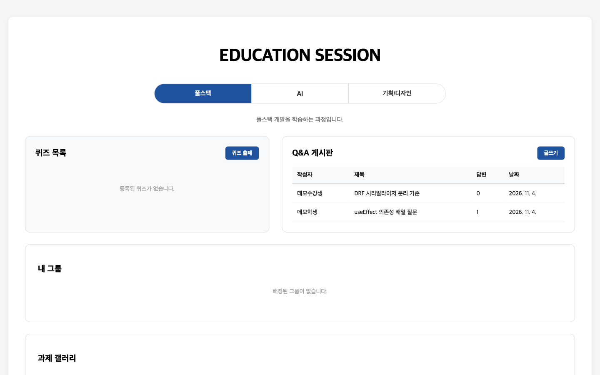
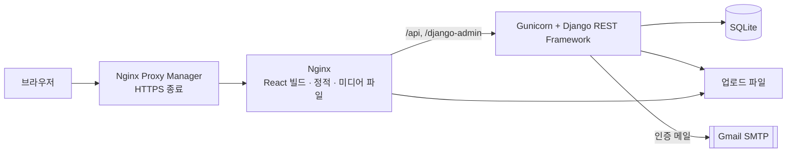

<div align="center">


# LIKELION SCH

**멋쟁이사자처럼 순천향대학교 14기 모집 · 심사 · 교육 운영 플랫폼**

지원서 접수부터 서류·면접 채점, 합격 처리, 합격 후 교육 세션 운영까지 한곳에서 다루기 위해 만든 풀스택 웹 서비스입니다.


</div>

> [!NOTE]
> **서비스는 2026년 7월에 운영을 종료했습니다.** 이 저장소는 코드를 보존하기 위한 것이며, 현재 접속할 수 있는 운영 서버는 없습니다.

---

## 프로젝트 정보

| 항목 | 내용 |
|------|------|
| 소속 | 멋쟁이사자처럼 순천향대학교 14기 |
| 활동 기간 | 2026-03 ~ 2027-01 |
| 서비스 운영 | 2026년 7월 종료 |
| 개발 기록 | 첫 커밋 2026-02-12, 마지막 코드 커밋 2026-04-05 |
| 본인 역할 | 디자인을 제외한 모든 역할 (2026-05-19까지 커밋 35개 중 32개) |

---

## 목차

- [심사 흐름](#심사-흐름)
- [화면 구성](#화면-구성)
- [주요 기능](#주요-기능)
- [보안 설계](#보안-설계)
- [아키텍처](#아키텍처)
- [기술 스택](#기술-스택)
- [실행 방법](#실행-방법)
- [테스트](#테스트)
- [API 개요](#api-개요)
- [역할별 접근 권한](#역할별-접근-권한)
- [프로젝트 구조](#프로젝트-구조)
- [라이선스](#라이선스)

---

## 심사 흐름



- 채점은 서류와 면접을 구분하고, 운영진 한 명이 지원서마다 종류별로 하나의 점수를 남깁니다. 점수는 항목 3개로 나뉩니다.
- 최종 확정은 서류 합격이 확정된 지원서에만 할 수 있습니다.
- 최종 합격하면 계정 역할이 `STUDENT`로 바뀝니다. 프론트엔드·백엔드 지원자는 풀스택 교육 트랙으로 배정됩니다.
- 지원자는 운영진이 결과를 공개한 뒤에야 서류·최종 결과를 볼 수 있습니다.

---

## 화면 구성

<table>
  <tr>
    <td align="center" width="50%">
      <br/>
      <sub><b>메인 페이지</b></sub>
    </td>
    <td align="center" width="50%">
      <br/>
      <sub><b>지원서</b><br/>제출 후에는 수정할 수 없습니다</sub>
    </td>
  </tr>
  <tr>
    <td align="center" width="50%">
      <br/>
      <sub><b>지원자 목록</b><br/>검색 · 필터 · 정렬 · 결과 확정 · 엑셀 다운로드</sub>
    </td>
    <td align="center" width="50%">
      <br/>
      <sub><b>서류 채점</b><br/>항목별 점수와 코멘트</sub>
    </td>
  </tr>
  <tr>
    <td align="center" width="50%">
      <br/>
      <sub><b>관리자 페이지</b><br/>메뉴 이동과 트랙별 지원 활성화</sub>
    </td>
    <td align="center" width="50%">
      <br/>
      <sub><b>교육 세션</b><br/>퀴즈 · Q&amp;A · 그룹 · 과제 갤러리</sub>
    </td>
  </tr>
</table>

> 로컬 환경에서 더미 데이터로 캡처했습니다. 화면의 이름, 학번, 메일 주소는 모두 가상의 값입니다.
> 디자인 시안은 [`FIgma/`](FIgma/) 폴더에 있습니다.

---

## 주요 기능

| 영역 | 기능 |
|------|------|
| **홈페이지** | 동아리 소개, 연간 로드맵, 트랙 소개와 커리큘럼, 운영진 소개, 프로젝트 목록 |
| **계정** | `@sch.ac.kr` 메일 인증 회원가입, 로그인, 비밀번호 재설정 |
| **지원** | 트랙별 질문이 다른 지원서 작성, 임시저장, 제출, 결과 확인 |
| **심사** | 지원자 검색·필터·정렬, 서류·면접 채점, 서류·최종 결과 확정, 엑셀 내보내기 |
| **모집 운영** | 트랙별 지원 활성화, 결과 공개 여부 설정, 지원자별 면접 일정 지정 |
| **교육 세션** | 풀스택 퀴즈·Q&A, AI·기획 과제 제출과 공지, 학생 그룹, 출석부, 수업 감상평, 풀스택 과제 갤러리(PDF) |
| **콘텐츠 관리** | 프로젝트(썸네일·PDF)와 메인 페이지 로드맵 항목 관리 |

---

## 보안 설계

- **인증 코드:** 메일 인증 코드는 해시로 저장하고 만료 시간을 둡니다.
- **세션과 CSRF:** 세션 쿠키로 인증하고, 프론트엔드의 API 클라이언트가 요청에 CSRF 토큰을 담아 보냅니다.
- **운영 설정:** `DEBUG=False`이면 쿠키 Secure, HTTPS 리다이렉트, HSTS를 적용하고, 기본 `SECRET_KEY`로는 서버가 시작되지 않습니다.
- **요청 제한:** DRF Throttling으로 비로그인 분당 30회, 로그인 사용자 분당 60회로 제한합니다.
- **업로드 검증:** 프로젝트 썸네일은 Pillow로 형식을 확인하고(5MB), 프로젝트 PDF는 파일 시그니처를 확인합니다(20MB). 과제 PDF는 확장자와 content-type을 검사합니다.
- **경로 차단:** Nginx에서 숨김 파일과 흔한 스캔 경로 요청을 차단합니다.

---

## 아키텍처



개발 환경에서는 Vite dev server가 `/api`와 `/media` 요청을 Django로 넘깁니다.

---

## 기술 스택

| 영역 | 기술 |
|------|------|
| 프론트엔드 | React 19 · TypeScript 5 · Vite 7 · React Router 7 · 일반 CSS |
| 백엔드 | Python 3.11 · Django 4.2 · Django REST Framework 3.16 |
| 인증 | Django 세션 · CSRF 토큰 · 메일 인증 |
| 데이터 | SQLite |
| 파일 처리 | Pillow(이미지 검증) · openpyxl(엑셀 내보내기) |
| 배포 | Docker Compose · Nginx · Nginx Proxy Manager · Gunicorn · WhiteNoise |

---

## 실행 방법

### 준비물

- Python 3.11
- Node.js 20.19 이상
- Docker Compose (Docker로 실행할 때만)

### 1. 백엔드

```bash
cd backend
python3.11 -m venv .venv
source .venv/bin/activate
pip install -r requirements.txt
cp .env.example .env
python manage.py migrate
python manage.py runserver    # http://127.0.0.1:8000
```

### 2. 프론트엔드

```bash
cd frontend
npm ci
npm run dev                   # http://localhost:5173
```

두 서버를 함께 실행해야 합니다.

### 3. 계정 준비

회원가입은 `@sch.ac.kr` 메일로만 할 수 있고, 인증 메일을 보내려면 `backend/.env`에 `EMAIL_HOST_USER`와 `EMAIL_HOST_PASSWORD`를 넣어야 합니다.
메일 없이 운영진 화면을 보려면 인증이 끝난 계정을 직접 만듭니다.

```bash
cd backend
python manage.py shell -c "from users.models import User; User.objects.create_superuser('admin@sch.ac.kr', '비밀번호', name='관리자', role='INSTRUCTOR', email_verified=True)"
```

### 4. Docker

```bash
cp .env.example .env          # SECRET_KEY, ALLOWED_HOSTS 등을 실제 값으로 변경
docker compose up -d --build
docker compose exec backend python manage.py migrate
```

프록시와 HTTPS 설정, 백업 방법은 [`DEPLOY.md`](DEPLOY.md)에 정리했습니다.

---

## 테스트

```bash
cd backend
python manage.py test         # 백엔드 실행 단계의 .env가 필요합니다
```

핵심 흐름의 백엔드 API를 테스트합니다. 메일은 실제로 발송하지 않습니다.

| 범위 | 확인하는 내용 |
|------|--------------|
| `users` | 메일 인증, 가입 조건과 유효시간, 로그인, CSRF, 비밀번호 재설정 |
| `applications` | 임시저장·제출과 잠금, 관리자 API 권한, 채점, 서류·최종 확정, 결과 공개 |
| `sessionsapp` | 과제 PDF 제출과 삭제 권한 |

프론트엔드 테스트와 CI는 없습니다.

---

## API 개요

Base URL: `/api`

| 모듈 | 주요 엔드포인트 |
|------|----------------|
| 인증 | `GET /auth/csrf` · `POST /auth/login` · `/auth/logout` · `/auth/signup` · `GET /auth/me` · `POST /auth/email/send-code` · `/auth/email/verify` · `/auth/password/send-code` · `/auth/password/reset` |
| 지원 | `/applications/my` · `/applications/draft` · `/applications/submit` · `/applications/results/my` · `/applications/track-settings` |
| 심사 | `/applications/admin` · `/admin/export` · `/admin/<id>` · `/admin/<id>/scores` · `/admin/<id>/doc-finalize` · `/admin/<id>/finalize` · `/admin/<id>/interview-schedule` · `/admin/notification-settings` |
| 교육 세션 | `/sessions/quizzes/` · `/qna/` · `/assignments/` · `/announcements/` · `/attendance/` · `/groups/` · `/class-reviews/` · `/homework-categories/` |
| 콘텐츠 | `/projects/` · `/roadmap/` · `/roadmap/admin` |
| 상태 확인 | `GET /health` |

심사와 교육 세션 경로의 뒷부분은 각각 `/applications`, `/sessions` 아래에 있습니다.

---

## 역할별 접근 권한

| 역할 | 접근할 수 있는 페이지 |
|------|----------------------|
| 비로그인 | 홈, 로그인, 회원가입, 비밀번호 재설정, 운영진, 트랙 소개 |
| `APPLICANT` (지원자) | 지원서 작성, 결과 확인 |
| `STUDENT` (수강생) | 교육 세션 |
| `INSTRUCTOR` (운영진) | 교육 세션, 관리자 페이지, 지원자 심사, 세션·프로젝트·로드맵 관리 |

---

## 프로젝트 구조

```
.
├── frontend/                React + Vite
│   ├── src/
│   │   ├── main.tsx         라우트 정의
│   │   ├── pages/           페이지와 CSS
│   │   ├── components/      공통 컴포넌트
│   │   ├── auth/            useAuth · RequireAuth
│   │   └── api/             API 클라이언트
│   ├── Dockerfile
│   └── nginx.conf
├── backend/                 Django + DRF
│   ├── config/              설정 · 루트 URL
│   ├── users/               사용자 모델 · 인증 · 메일 인증
│   ├── applications/        지원서 · 채점 · 결과 · 모집 설정
│   ├── sessionsapp/         퀴즈 · Q&A · 과제 · 출석 · 그룹 · 감상평
│   ├── projects/            프로젝트 관리
│   ├── roadmap/             로드맵 관리
│   └── Dockerfile
├── docs/screenshots/        README 이미지
├── FIgma/                   디자인 시안
├── docker-compose.yml
└── DEPLOY.md
```

---

## 라이선스

[MIT License](LICENSE)
